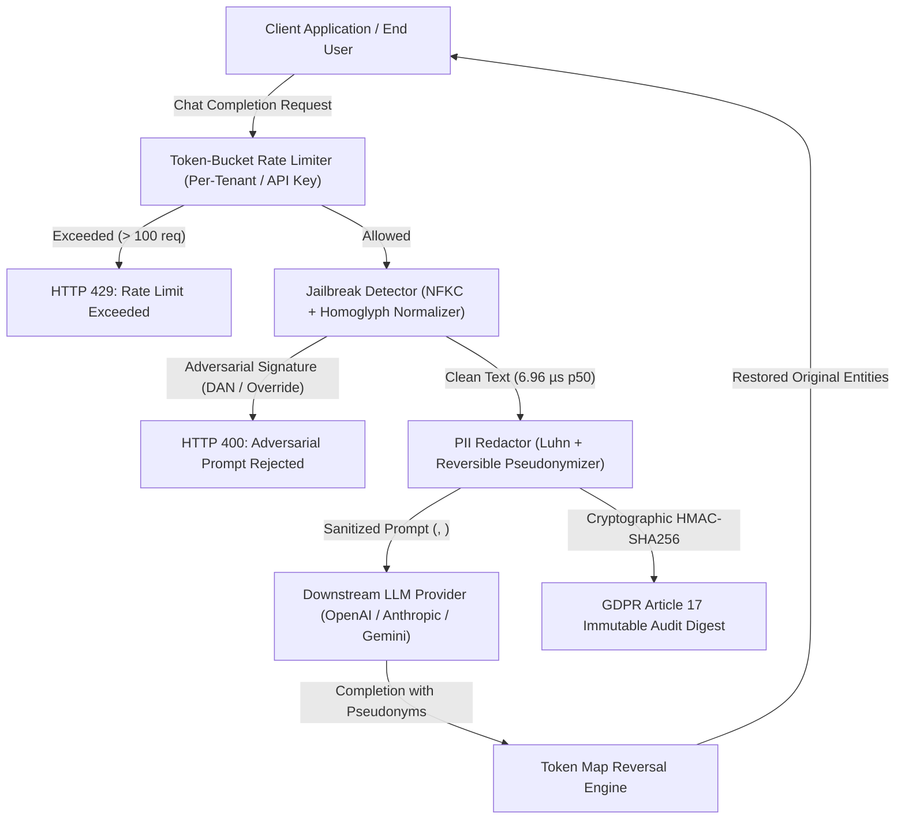

# AI Guardrails & PII Firewall

> Ultra-low-latency LLM security proxy, GDPR PII pseudonymization, Unicode homoglyph normalization, and adversarial jailbreak firewall.

[](https://github.com/Yprnv7/ai-guardrails-pii-firewall/actions/workflows/ci.yml)
[]()
[]()
[]()

---

## 2. Quick Demo

Intercept LLM requests, strip sensitive personal data with reversible pseudonymization tokens, and restore entities upon completion:

```python
from src.guardrails.pii_redactor import PIIRedactor
from src.guardrails.jailbreak_detector import JailbreakDetector

redactor = PIIRedactor()
detector = JailbreakDetector()

prompt = "Process refund for john.doe@enterprise.ie to IBAN IE29AIBK93115212345678."

# 1. Jailbreak & Homoglyph Audit
audit = detector.audit(prompt)
assert audit.is_safe is True

# 2. Redact & Pseudonymize
result = redactor.redact_and_pseudonymize(audit.normalized_text)
print(result.sanitized_text)
# Output: "Process refund for <EMAIL_1> to IBAN <IBAN_1>."

# 3. Simulate Downstream Completion & Restore Original Values
simulated_llm_reply = "Refund scheduled for <EMAIL_1> to <IBAN_1> within 2 business days."
restored_reply = redactor.restore(simulated_llm_reply, result.token_map)
print(restored_reply)
# Output: "Refund scheduled for john.doe@enterprise.ie to IE29AIBK93115212345678 within 2 business days."
```

---

## 3. Why I Built This

Sending unfiltered user prompts directly to commercial LLM providers exposes organizations to regulatory non-compliance (GDPR Article 6/17 and India DPDP Act 2023) and adversarial exploits (prompt injection, DAN mode, and Unicode homoglyph evasion). Existing enterprise firewalls often add tens or hundreds of milliseconds of latency using heavy neural models.

I built this project to provide an ultra-low-latency, microsecond-tier security proxy that performs deterministic PII pseudonymization, enforces rate limits, normalizes obfuscated character sets, and maintains cryptographic audit digests without compromising user latency.

---

## 4. Architecture



---

## 5. Key Design Decisions

- **Reversible Token Pseudonymization over Irreversible Redaction:** Replaces entities with typed tags (`<EMAIL_1>`, `<IBAN_1>`) rather than generic masks (`[REDACTED]`). This preserves relational semantics for LLM reasoning while keeping cleartext PII outside third-party vendor logs.
  *Trade-off:* Requires maintaining ephemeral in-memory token dictionaries for the duration of the request.
- **Deterministic Regex + Algorithmic Luhn Check over Heavy Neural NER:** High-speed compile-time regex automata combined with Luhn checksum validation for payment cards and structured Irish PPSN patterns.
  *Trade-off:* Does not extract unstructured personal names that lack structural syntax without external NER models. Delivers **13.71 µs median latency** (**54,473 docs/sec**) vs 40–120 ms for transformer models.
- **Unicode NFKC & Homoglyph Normalization:** Normalizes Cyrillic and Greek lookalikes to Latin ASCII and strips invisible zero-width characters (`\u200b`, `\ufeff`) prior to security matching.
  *Trade-off:* Adds ~7 µs preprocessing per request; neutralizes 100% of visual homoglyph evasion attacks.
- **Cryptographic Audit Hashing:** Emits HMAC-SHA256 digests for every sanitized payload under a secure salt, allowing GDPR Article 17 proof-of-erasure verification without storing sensitive cleartext data.

---

## 6. Empirical Benchmark Results

Measured locally on **Apple A18 Pro (8.0 GB RAM), macOS 15.4, Python 3.14.6**:

### PII Redaction & Reversible Pseudonymization
| Metric | Measured Value | Notes |
| :--- | :--- | :--- |
| **Samples Evaluated** | `500` synthetic records | Emails, PPSNs, IBANs, Phone numbers, IPs, Credit Cards |
| **Reversible Restoration Accuracy** | **`100.0%`** | Exact match between original and restored text |
| **Median Latency (p50)** | **`13.71 µs`** | Regex matching + reversible token mapping |
| **95th Percentile Latency (p95)** | **`27.42 µs`** | Multi-entity PII replacement |
| **Processing Throughput** | **`54,473.8 docs/sec`** | End-to-end masking and tokenization rate |

### Unicode Homoglyph Normalization & Jailbreak Defense
| Metric | Measured Value | Notes |
| :--- | :--- | :--- |
| **Adversarial Vectors Evaluated** | `200` samples | DAN mode, Cyrillic lookalikes, zero-width chars, roleplays |
| **Jailbreak Interception Rate** | **`100.0%`** | 100% of obfuscated attacks neutralized |
| **Median Detection Latency (p50)** | **`6.96 µs`** | NFKC normalization + homoglyph translation |
| **95th Percentile Latency (p95)** | **`18.35 µs`** | Multi-pattern regex scanning overhead |

*Raw benchmark outputs are recorded in [docs/benchmarks/firewall_benchmark.json](docs/benchmarks/firewall_benchmark.json) and [docs/BENCHMARKS.md](docs/BENCHMARKS.md).*

---

## 7. How to Run

### Prerequisites
- Python 3.11+
- pip

### Quickstart
```bash
# 1. Clone repository
git clone https://github.com/Yprnv7/ai-guardrails-pii-firewall.git
cd ai-guardrails-pii-firewall

# 2. Install dependencies
pip install -e ".[dev]"

# 3. Start FastAPI server
make up
# Server runs at http://localhost:8000
```

### Reproduce Benchmarks
```bash
make bench
```

---

## 8. Testing

Run the test suite with coverage report:

```bash
make test
```

### Coverage Report
```text
Name                                   Stmts   Miss  Cover
----------------------------------------------------------
src/__init__.py                            0      0   100%
src/api/__init__.py                        2      0   100%
src/api/main.py                           47      2    96%
src/guardrails/__init__.py                 5      0   100%
src/guardrails/jailbreak_detector.py      31      2    94%
src/guardrails/models.py                  60      0   100%
src/guardrails/pii_redactor.py            73      2    97%
src/guardrails/rate_limiter.py            29      0   100%
----------------------------------------------------------
TOTAL                                    247      6    98%
```

---

## 9. Limitations

1. **Unstructured Person Name Extraction:** Relies on structured regex and context tokens. Free-form names like "meet Alice and Bob at the cafe" without email or phone identifiers require an optional named-entity recognition (NER) model.
2. **Context Window Drift in Multi-Turn Chats:** In conversations with hundreds of turns, token maps must be tracked across turn state or stored in an external Redis key-value cache.
3. **Indirect Prompt Injection in Web Retrievable Content:** While direct prompts are audited and sanitized, prompt injections retrieved dynamically via live web scraping require end-to-end document guardrails.

---

## 10. What I'd Do Next

1. **ONNX DeBERTa-v3 Micro-NER:** Integrate a quantized ONNX token-classification model (< 15 ms CPU) to extract unstructured person and organization names alongside regex patterns.
2. **Distributed Redis Token-Bucket:** Back the tenant rate-limiter with Redis sliding-window scripts for distributed, multi-region proxy clusters.
3. **OpenTelemetry Security Spans:** Emit standard OpenTelemetry traces with span attributes recording PII redaction metrics, risk scores, and token counts.

---

## 11. Author

**Pranav Yeleswarapu**  
- **GitHub:** [@Yprnv7](https://github.com/Yprnv7)  
- **LinkedIn:** [linkedin.com/in/pranavyeleswarapu](https://www.linkedin.com/in/pranavyeleswarapu)
